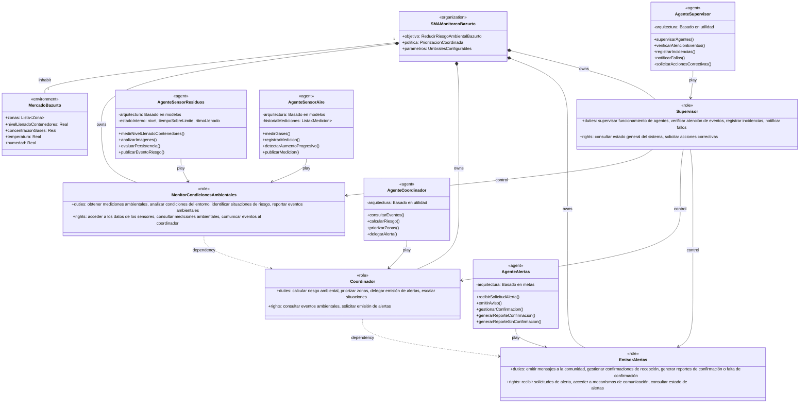
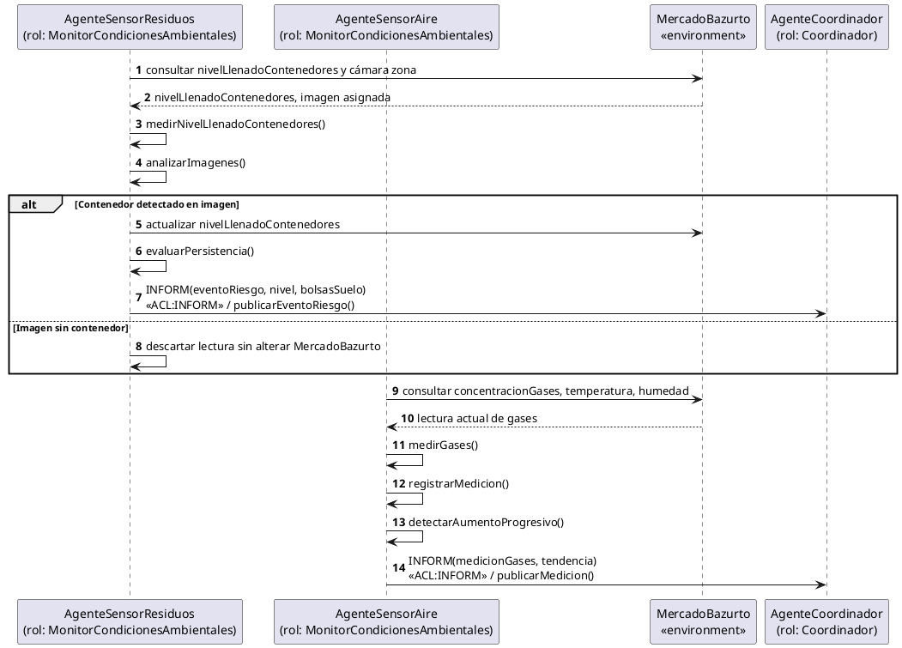
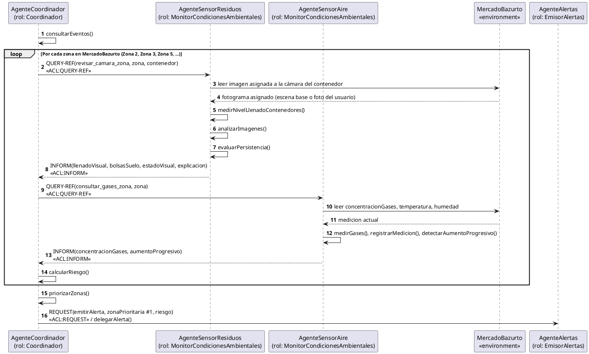
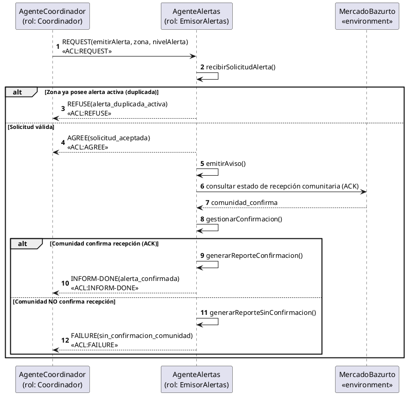
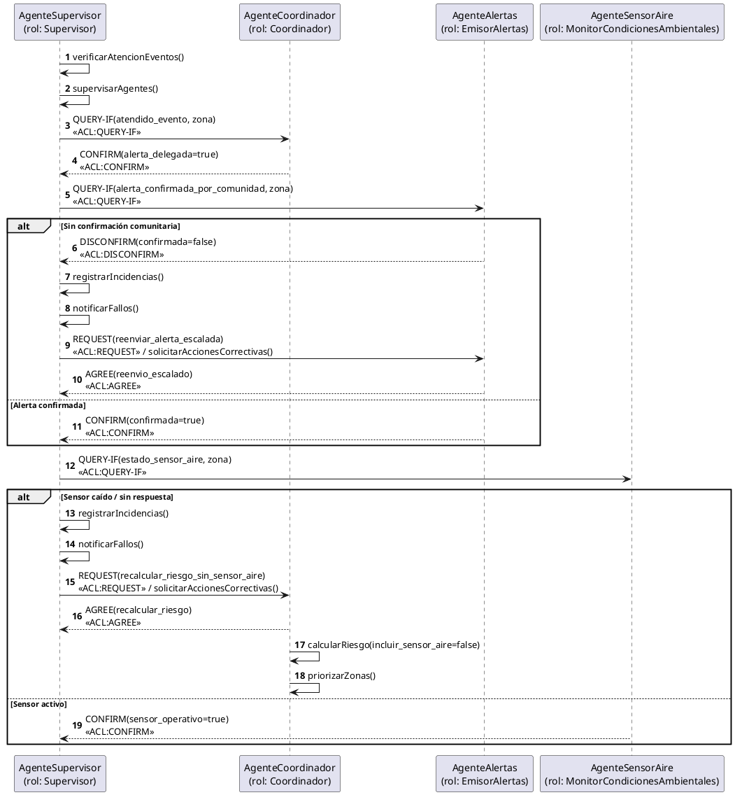
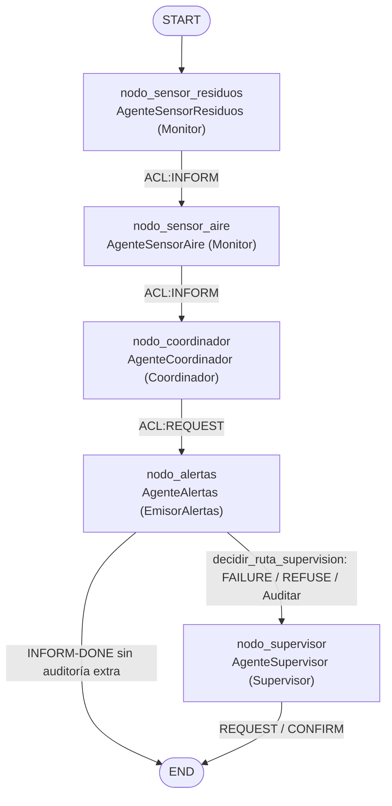

# SMAMonitoreoBazurto (Versión 2 Completa) — IA Multimodal Híbrida + 4 Casos de Uso por Rol

## 1. Arquitectura Híbrida de Visión (`AgenteSensorResiduos.analizarImagenes()`)
Para responder a escenarios reales con conectividad y escenarios portátiles sin internet (como una sustentación en sala de clase con `.zip`), el agente `AgenteSensorResiduos` opera en modo híbrido:

1. **IA Multimodal Real (Gemini 2.5 Flash):** Cuando hay conexión a internet y una `Gemini API Key` configurada en la consola (o en la variable de entorno `GEMINI_API_KEY`), el agente envía el fotograma al modelo multimodal para identificar semánticamente contenedores, nivel de llenado real, bolsas/residuos en el suelo, coordenadas delimitadoras (`box_2d`) y una explicación redactada en lenguaje natural (`explicacion_ia`).
2. **Motor Matemático HSV Local (100% Offline):** Cuando no hay clave o no hay conexión, el sistema conmuta automáticamente al analizador cromático local (`200×200` en Pillow para Python / `<canvas>` en el navegador), midiendo píxeles en espacios HSV (`estructura_px`, `boca_residuos_px`, `cavidad_residuos_px`, `suelo_residuos_px`, `cavidad_vacia_px`), descartando imágenes sin contenedores y calculando el porcentaje y número de bolsas sin valores fijos pregrabados.

---

## 2. Diagrama de Clases MAS-ML (Base y Regla de Dependencia)

> **Regla de flechas `dependency` (criterio del docente):** En `A ..> B : dependency`, el rol en la punta (`B`) depende del rol en el rabo (`A`). Por ello, `Coordinador` depende de `MonitorCondicionesAmbientales`, y `EmisorAlertas` depende de `Coordinador`.

---

## 3. Desglose Formal: 4 Casos de Uso por cada `<<role>>`

### Ficha CU-ROL-01 — Rol `MonitorCondicionesAmbientales`
- **Nombre:** Monitoreo visual de contenedores y medición continua de gases en `MercadoBazurto`.
- **Rol involucrado:** `MonitorCondicionesAmbientales` (`AgenteSensorResiduos`, `AgenteSensorAire`).
- **Actores externos / Entorno:** `MercadoBazurto` (`zonas`, `nivelLlenadoContenedores`, `concentracionGases`, `temperatura`, `humedad`).
- **Precondiciones:** Zonas y cámaras de contenedores registradas en el entorno.
- **Flujo principal:**
  1. `AgenteSensorResiduos` consulta `MercadoBazurto` (`medirNivelLlenadoContenedores()`).
  2. Ejecuta `analizarImagenes()` sobre la imagen asignada al contenedor (IA Gemini 2.5 Flash o cálculo HSV offline).
  3. Descarta imágenes sin contenedor (`sin_contenedor_detectado`) o actualiza la persistencia (`evaluarPersistencia()`).
  4. Publica evento de riesgo al Coordinador (`publicarEventoRiesgo()`, ACL `INFORM`).
  5. `AgenteSensorAire` ejecuta `medirGases()`, `registrarMedicion()`, `detectarAumentoProgresivo()` y `publicarMedicion()` (`INFORM`).

### Ficha CU-ROL-02 — Rol `Coordinador` (Inspección Coordinada de las 3 Cámaras)
- **Nombre:** Consulta activa de cámaras de todas las zonas, cálculo de utilidad ambiental y priorización coordinada.
- **Rol involucrado:** `Coordinador` (`AgenteCoordinador`).
- **Precondiciones:** Cada zona cuenta con una imagen asignada (por defecto `contenedor_limpio.png` en Zona 2, `contenedor_critico.png` en Zona 3 y `contenedor_medio.png` en Zona 5, o fotografías cargadas por el usuario).
- **Flujo principal:**
  1. `AgenteCoordinador` ejecuta `consultarEventos()` y envía un `ACL:QUERY-REF` (`FIPA-Query`) a `AgenteSensorResiduos` solicitando revisar la cámara de cada zona, y a `AgenteSensorAire` solicitando los niveles de gases.
  2. `AgenteSensorResiduos` inspecciona cada imagen (`analizarImagenes()`) y responde mediante `ACL:INFORM` reportando nivel de llenado, bolsas en el suelo y explicación.
  3. `AgenteCoordinador` calcula el índice de riesgo por utilidad (`calcularRiesgo()`) para todas las zonas inspeccionadas.
  4. Ordena todas las zonas según `PriorizacionCoordinada` (`priorizarZonas()`).
  5. Delega la emisión de alerta para la zona prioritaria `#1` mediante `delegarAlerta()` (`ACL:REQUEST` a `AgenteAlertas`).

### Ficha CU-ROL-03 — Rol `EmisorAlertas`
- **Nombre:** Recepción de solicitudes de alerta, aviso comunitario y gestión de confirmaciones.
- **Rol involucrado:** `EmisorAlertas` (`AgenteAlertas`).
- **Flujo principal:**
  1. `AgenteAlertas` recibe la delegación (`recibirSolicitudAlerta()`) y valida no duplicidad (`AGREE` o `REFUSE`).
  2. Emite el aviso al panel comunitario (`emitirAviso()`).
  3. Gestiona la confirmación de líderes de zona (`gestionarConfirmacion()`).
  4. Si confirman (`ACK`), ejecuta `generarReporteConfirmacion()` y cierra con `ACL:INFORM-DONE`. Si no confirman, ejecuta `generarReporteSinConfirmacion()` y cierra con `ACL:FAILURE`.

### Ficha CU-ROL-04 — Rol `Supervisor`
- **Nombre:** Supervisión integral de agentes, auditoría de eventos sin confirmación y acciones correctivas.
- **Rol involucrado:** `Supervisor` (`AgenteSupervisor`).
- **Flujo principal:**
  1. `AgenteSupervisor` ejecuta `supervisarAgentes()` y `verificarAtencionEventos()`.
  2. Envía `ACL:QUERY-IF` (`FIPA-Query`) a `AgenteCoordinador` (`CONFIRM`), a `AgenteAlertas` (`CONFIRM` / `DISCONFIRM`) y a `AgenteSensorAire` (`CONFIRM` / timeout).
  3. Si detecta falta de confirmación o sensor caído, registra la incidencia (`registrarIncidencias()`), notifica fallos (`notificarFallos()`) y envía `ACL:REQUEST` con `solicitarAccionesCorrectivas()` (escalamiento comunitario o recálculo de riesgo sin sensor de aire).

---

## 4. Diagramas de Secuencia en PlantUML (4 Casos de Uso por Rol)

### 4.1 Diagrama de Secuencia `CU-ROL-01` (`MonitorCondicionesAmbientales`)

### 4.2 Diagrama de Secuencia `CU-ROL-02` (`Coordinador` — Orden de Revisión de Cámaras)

### 4.3 Diagrama de Secuencia `CU-ROL-03` (`EmisorAlertas`)

### 4.4 Diagrama de Secuencia `CU-ROL-04` (`Supervisor`)

---

## 5. Integración de los 7 Frameworks Multiagente del Profesor (`LangGraph`, `CrewAI`, `MAF Microsoft`, `Google ADK`, `JADE`, `AutoGen` y `Agent SDK`)

En reemplazo de `n8n` (cuya limitación principal era no conservar memoria persistente entre ejecuciones para atributos como `estadoInterno.tiempoSobreLimite` o `historialMediciones`), el módulo [`app/multiagent_frameworks.py`](app/multiagent_frameworks.py) implementa un **Grafo de Estados (`BazurtoStateGraphRunner`)** respaldado por **LangGraph (`StateGraph` + `MemorySaver`)** y persistencia en SQLite (`bazurto_sma.db`), junto con los adaptadores y definiciones formales para los **7 frameworks multiagente** indicados por el docente:

### 5.1 Arquitectura del `StateGraph` de 5 Nodos (Conectado al Backend Real)

Cada ejecución guarda un `thread_id` único en el checkpointer (`MemorySaver` + SQLite `bazurto_sma.db`), conservando `tiempoSobreLimite`, `ritmoLlenado`, `historialMediciones_count`, `riesgo`, `resultado_acl` e `incidencias_supervisor`. Además, si la consola se ejecuta desde el `.zip` en un equipo universitario sin internet ni dependencias extra, el motor activa automáticamente un `FallbackStateGraph` 100% compatible con la API de `LangGraph`.

### 5.2 Tabla Comparativa de los 7 Frameworks Soportados

| # | Framework | Creador | Paradigma | Cómo Resuelve la Persistencia (vs `n8n`) | Mapeo con `SMAMonitoreoBazurto` |
| :-: | :--- | :--- | :--- | :--- | :--- |
| 1 | **LangGraph** | LangChain Inc. | Grafo cíclico `StateGraph` con aristas condicionales | `BazurtoAgentState` + `MemorySaver`/`SqliteSaver` por `thread_id` | Cada agente es un nodo real ejecutado secuencial y condicionalmente |
| 2 | **CrewAI** | CrewAI Inc. | Equipos jerárquicos por `Agent` + `Task` + `Crew` | `memory=True` con persistencia de entidades en SQLite | Mapeo directo 1:1 con los 4 `<<role>>` (`manager_agent=Coordinador`) |
| 3 | **MAF (Microsoft Agent Framework)** | Microsoft | `ChatCompletionAgent` + `AgentGroupChat` + Plugins | Hilos persistentes (`AgentThread`) y `ChatHistory` centralizado | Métodos MAS-ML expuestos como `KernelPlugins` auditables |
| 4 | **Google ADK** | Google | `ParallelAgent` + `SequentialAgent` + `LlmAgent` (`gemini-2.5-flash`) | `DatabaseSessionService` + `ToolContext.state` persistente | `ParallelAgent(Residuos, Aire)` -> `SequentialAgent(Coordinador, Alertas, Supervisor)` |
| 5 | **JADE** | TILAB (IEEE FIPA) | Plataforma FIPA nativa (`ACLMessage`, `CyclicBehaviour`, DF) | Agentes residentes en `Container` con persistencia JDBC/SQLite | Estándar nativo `QUERY-REF`, `INFORM`, `REQUEST`, `AGREE`, `FAILURE`, `QUERY-IF` |
| 6 | **AutoGen** | Microsoft Research / AG2 | Conversación multiagente (`AssistantAgent` + `GroupChat`) | Historial compartido entre turnos y estado en SQLite | Grupo conversacional moderado por `AgenteCoordinador` y auditado por `AgenteSupervisor` |
| 7 | **Agent SDK** | OpenAI | Agentes ligeros con `handoffs()` y `@function_tool` | `SQLiteSession` integrada en `Runner.run(..., session=...)` | Traspasos explícitos `Monitor -> Coordinador -> Alertas -> Supervisor` |

### 5.3 Endpoints REST y Uso Offline

- `GET /api/frameworks`: Retorna el catálogo completo de los 7 frameworks, estado nativo de `LangGraph` y definición del `StateGraph`.
- `POST /api/frameworks/ejecutar`: Recibe `framework_id` (`langgraph`, `crewai`, `microsoft_maf`, `google_adk`, `jade`, `autogen`, `agent_sdk`), `zona_id` y `comunidad_confirma`; ejecuta realmente el grafo de 5 nodos y devuelve los nodos visitados, transiciones, snapshot del checkpoint y la traza `FIPA-ACL`.
- **Modo Autónomo 100% Offline (`index.html` / `ABRIR_SIN_INSTALAR_OFFLINE.bat`)**: Replica ambos endpoints sobre `localStorage` para demostraciones sin Python instalado.
