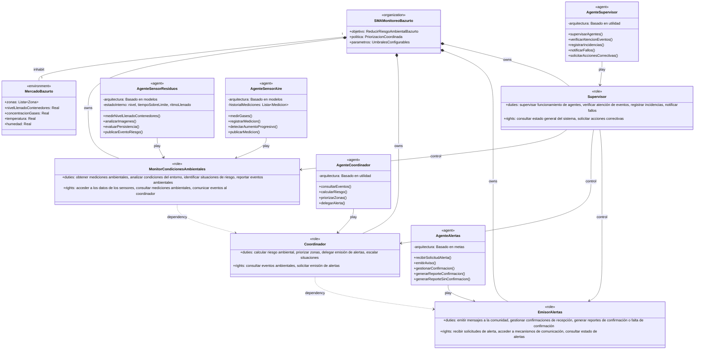
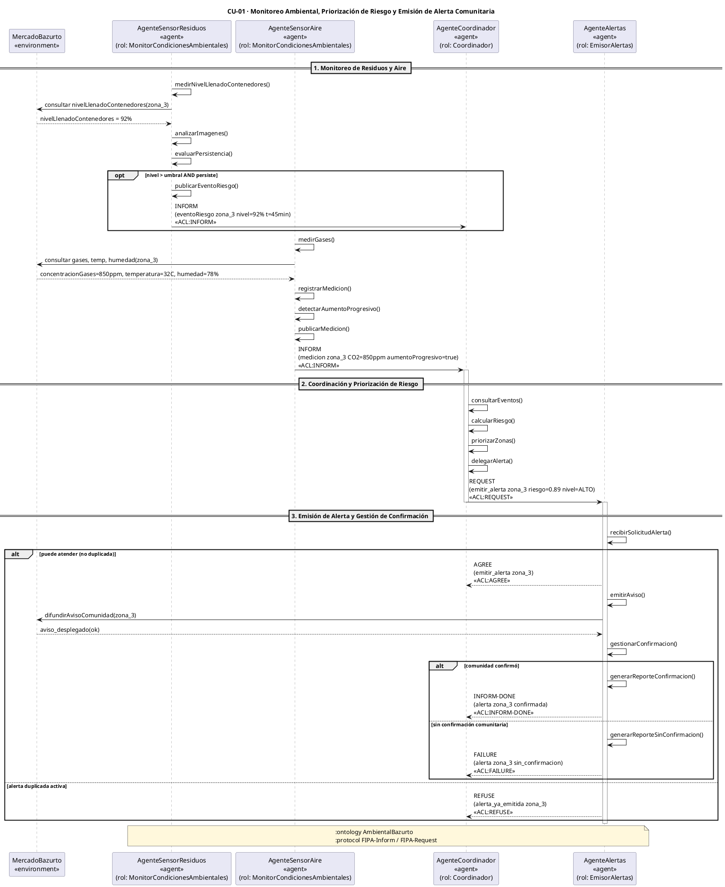
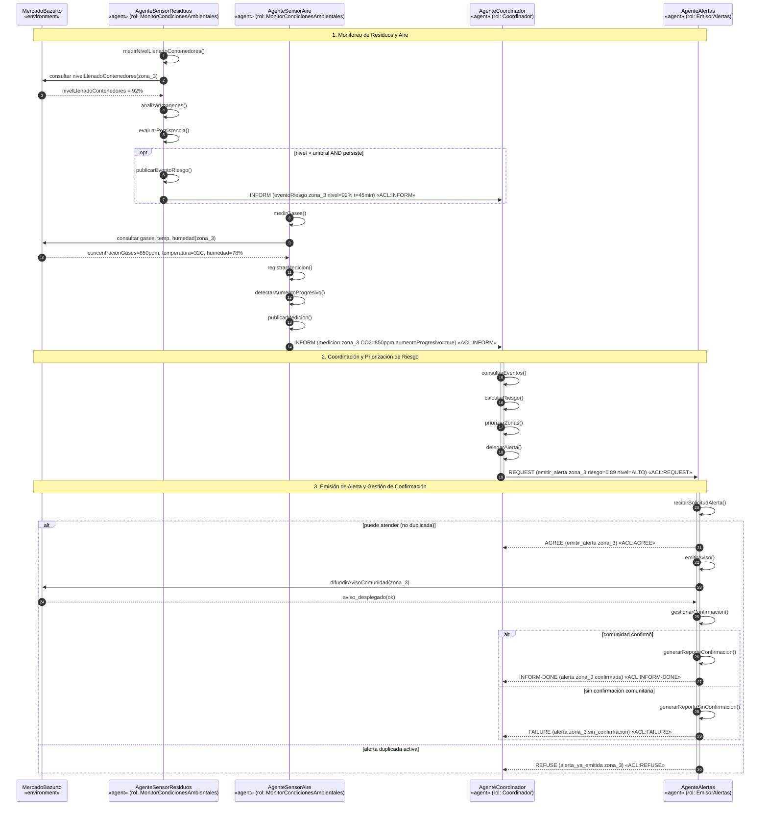
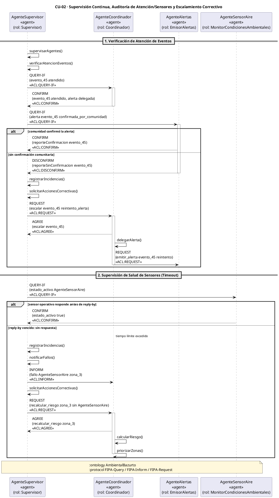
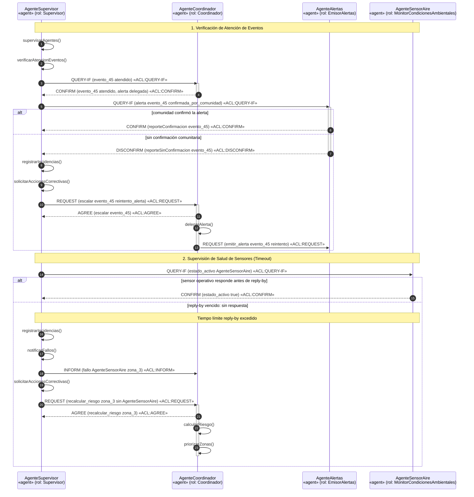

# Documentación Técnica Oficial — Sistema Multiagente de Monitoreo Ambiental (`SMAMonitoreoBazurto`)

> **Estándares aplicados**: MAS-ML (Multi-Agent System Modeling Language) + FIPA-ACL (Foundation for Intelligent Physical Agents — Agent Communication Language)  
> **Ontología compartida**: `AmbientalBazurto`  
> **Protocolos de interacción**: `FIPA-Inform`, `FIPA-Query`, `FIPA-Request`  
> **Fecha**: Noviembre de 2026  

---

## 1. Diagrama de Clases MAS-ML Pulido

> [!IMPORTANT]
> **Corrección aplicada al Diagrama de Clases original**: Se estandarizó el nombre del método `+medirNivelLlenadoContenedores()` en `AgenteSensorResiduos` (corrigiendo el typo `Contenerdores`) para que coincida letra por letra con el atributo `+nivelLlenadoContenedores: Real` de `MercadoBazurto`, con los dos Diagramas de Secuencia y con el código fuente ejecutado.

### 1.1 Diagrama en Mermaid (`classDiagram`)



### 1.2 Tabla Semántica de Relaciones MAS-ML (Incluyendo Regla de Flechas del Profesor)

| Relación en el Diagrama | Tipo MAS-ML | Lectura Oficial y Criterio del Profesor |
| :--- | :--- | :--- |
| `SMAMonitoreoBazurto "1" -- "1" MercadoBazurto : inhabit` | `inhabit` | La organización `SMAMonitoreoBazurto` habita y opera dentro del entorno físico/lógico `MercadoBazurto`. |
| `SMAMonitoreoBazurto *-- <Rol> : owns` | `ownership` | La organización es propietaria y define los 4 roles (`MonitorCondicionesAmbientales`, `Coordinador`, `EmisorAlertas`, `Supervisor`). |
| `<Agente> --> <Rol> : play` | `play` | El agente desempeña el rol indicado (ej. `AgenteSensorResiduos` y `AgenteSensorAire` juegan el rol `MonitorCondicionesAmbientales`). |
| `Supervisor --> <Rol> : control` | `control` | Jerarquía de autoridad: el rol `Supervisor` ejerce control operativo sobre `MonitorCondicionesAmbientales`, `Coordinador` y `EmisorAlertas`. |
| `MonitorCondicionesAmbientales ..> Coordinador : dependency` | `dependency` | **Regla de lectura del profesor (Punta -> Rabo)**: `Coordinador` (**punta** de la flecha) **depende de** `MonitorCondicionesAmbientales` (**rabo** de la flecha) para obtener las mediciones y eventos de riesgo sin los cuales no puede calcular ni priorizar el riesgo. |
| `Coordinador ..> EmisorAlertas : dependency` | `dependency` | **Regla de lectura del profesor (Punta -> Rabo)**: `EmisorAlertas` (**punta** de la flecha) **depende de** `Coordinador` (**rabo** de la flecha) porque solo emite alertas cuando recibe la solicitud/delegación formal de riesgo priorizado. |

---

## 2. Especificación Formal de los 2 Casos de Uso

### Caso de Uso 1 (`CU-01`): Monitoreo Ambiental, Priorización de Riesgo y Emisión de Alerta Comunitaria

| Campo | Especificación |
| :--- | :--- |
| **Código** | `CU-01` |
| **Nombre** | Monitoreo Ambiental, Priorización de Riesgo y Emisión de Alerta Comunitaria |
| **Entorno** | `MercadoBazurto` (`<<environment>>`) |
| **Agentes Participantes y Roles** | `AgenteSensorResiduos` (rol `MonitorCondicionesAmbientales`), `AgenteSensorAire` (rol `MonitorCondicionesAmbientales`), `AgenteCoordinador` (rol `Coordinador`), `AgenteAlertas` (rol `EmisorAlertas`) |
| **Perspectivas FIPA-ACL** | **Cognitiva** (`INFORM`) · **Accional** (`REQUEST`, `AGREE`, `FAILURE`) · **Social** (`REFUSE`) · **Coordinativa** (`INFORM-DONE`) |
| **Protocolos** | `FIPA-Inform`, `FIPA-Request` |
| **Precondiciones** | Los agentes están registrados en la plataforma; `MercadoBazurto` contiene zonas monitoreadas con sensores de residuos y aire activos; el estado interno previo (`tiempoSobreLimite`, `ritmoLlenado`, `historialMediciones`) persiste en SQLite. |
| **Flujo Principal (Éxito)** | 1. `AgenteSensorResiduos` ejecuta `medirNivelLlenadoContenedores()` consultando a `MercadoBazurto` (retorna `nivelLlenadoContenedores`), analiza imágenes con `analizarImagenes()`, actualiza su modelo interno y evalúa persistencia con `evaluarPersistencia()`. Si supera umbral persistente, ejecuta `publicarEventoRiesgo()` y envía **`INFORM`** al `AgenteCoordinador`.<br>2. `AgenteSensorAire` ejecuta `medirGases()` consultando a `MercadoBazurto` (retorna `concentracionGases, temperatura, humedad`), persiste el dato en `historialMediciones` con `registrarMedicion()`, evalúa tendencia con `detectarAumentoProgresivo()`, ejecuta `publicarMedicion()` y envía **`INFORM`** al `AgenteCoordinador`.<br>3. `AgenteCoordinador` ejecuta `consultarEventos()`, `calcularRiesgo()`, `priorizarZonas()` y `delegarAlerta()`, enviando **`REQUEST`** al `AgenteAlertas`.<br>4. `AgenteAlertas` ejecuta `recibirSolicitudAlerta()`, responde **`AGREE`**, ejecuta `emitirAviso()` hacia la comunidad en `MercadoBazurto` y verifica recepción con `gestionarConfirmacion()`.<br>5. Si la comunidad confirma, ejecuta `generarReporteConfirmacion()` y envía **`INFORM-DONE`** al `AgenteCoordinador`. |
| **Flujos Alternativos** | **A1 (Sin confirmación de la comunidad)**: Tras `AGREE` y `emitirAviso()`, `gestionarConfirmacion()` detecta ausencia de acuse comunitario -> ejecuta `generarReporteSinConfirmacion()` y envía **`FAILURE`** al `AgenteCoordinador`.<br>**A2 (Alerta duplicada / No viable)**: En `recibirSolicitudAlerta()`, si ya existe una alerta activa reciente para la misma zona -> `AgenteAlertas` rechaza antes de ejecutar respondiendo **`REFUSE`**. |
| **Postcondiciones** | Las mediciones, el estado interno de ambos sensores, el riesgo priorizado, el estado de la alerta y todos los mensajes FIPA-ACL quedan persistidos en `bazurto_sma.db`. |

---

### Caso de Uso 2 (`CU-02`): Supervisión Continua, Auditoría de Atención/Sensores y Escalamiento Correctivo

| Campo | Especificación |
| :--- | :--- |
| **Código** | `CU-02` |
| **Nombre** | Supervisión Continua, Auditoría de Atención/Sensores y Escalamiento Correctivo |
| **Entorno** | `MercadoBazurto` (`<<environment>>`) |
| **Agentes Participantes y Roles** | `AgenteSupervisor` (rol `Supervisor`), `AgenteCoordinador` (rol `Coordinador`), `AgenteAlertas` (rol `EmisorAlertas`), `AgenteSensorAire` (rol `MonitorCondicionesAmbientales`) |
| **Perspectivas FIPA-ACL** | **Cognitiva** (`QUERY-IF`, `INFORM`) · **Coordinativa** (`CONFIRM`, `DISCONFIRM`) · **Accional** (`REQUEST`, `AGREE`) |
| **Protocolos** | `FIPA-Query`, `FIPA-Inform`, `FIPA-Request` |
| **Precondiciones** | Existe al menos un evento de riesgo registrado y una solicitud de alerta delegada en el sistema; el `AgenteSupervisor` ejerce la relación `control` sobre los roles supervisados. |
| **Flujo Principal (Verificación Exitosa)** | 1. `AgenteSupervisor` ejecuta `supervisarAgentes()` y `verificarAtencionEventos()`.<br>2. Envía **`QUERY-IF`** al `AgenteCoordinador` preguntando si el evento fue atendido -> `AgenteCoordinador` responde **`CONFIRM`**. <br>3. Envía **`QUERY-IF`** al `AgenteAlertas` preguntando si la alerta fue confirmada por la comunidad -> si fue confirmada, `AgenteAlertas` responde **`CONFIRM`**. <br>4. Envía **`QUERY-IF`** al `AgenteSensorAire` verificando su estado operativo activo -> si responde antes del `reply-by`, `AgenteSensorAire` devuelve **`CONFIRM`**. |
| **Flujos Alternativos** | **A1 (Alerta sin confirmación comunitaria -> `DISCONFIRM`)**: `AgenteAlertas` responde **`DISCONFIRM`** con el reporte de falta de confirmación. `AgenteSupervisor` ejecuta `registrarIncidencias()`, `solicitarAccionesCorrectivas()` y envía **`REQUEST`** de escalamiento al `AgenteCoordinador`. Este responde **`AGREE`**, ejecuta `delegarAlerta()` y envía un **`REQUEST`** de reintento al `AgenteAlertas`.<br>**A2 (Fallo o Timeout de `AgenteSensorAire`)**: Vence el tiempo `reply-by` sin respuesta del `AgenteSensorAire`. `AgenteSupervisor` ejecuta `registrarIncidencias()`, `notificarFallos()` (envía **`INFORM`** del fallo al `AgenteCoordinador`) y `solicitarAccionesCorrectivas()` (envía **`REQUEST`** de recálculo de riesgo sin ese sensor). `AgenteCoordinador` responde **`AGREE`** y ejecuta `calcularRiesgo()` y `priorizarZonas()` con los sensores disponibles. |
| **Postcondiciones** | Toda incidencia, notificación de fallo y acción correctiva ejecutada queda registrada con trazabilidad completa en SQLite. |

---

## 3. Diagrama de Secuencia — Caso de Uso 1 (`CU-01`)

### 3.1 Código PlantUML (Listo para `plantuml.com` / `planttext.com`)



### 3.2 Código Mermaid (`sequenceDiagram`)



### 3.3 Mensajes FIPA-ACL Clave de `CU-01` (S-expression y JSON)

**Mensaje 1 — `INFORM` de Residuos (S-expression):**
```lisp
(inform
  :sender AgenteSensorResiduos
  :receiver AgenteCoordinador
  :content (eventoRiesgo zona_3 nivel 92 tiempoSobreLimite 45 ritmoLlenado 14.5)
  :language SL
  :ontology AmbientalBazurto
  :protocol FIPA-Inform
  :conversation-id cu01-zona3-001
)
```

**Mensaje 2 — `REQUEST` de Coordinador a Alertas (JSON):**
```json
{
  "performative": "request",
  "sender": "AgenteCoordinador",
  "receiver": "AgenteAlertas",
  "content": {
    "action": "emitir_alerta",
    "params": {
      "zona": "zona_3",
      "riesgo": 0.89,
      "nivel": "ALTO"
    }
  },
  "ontology": "AmbientalBazurto",
  "protocol": "FIPA-Request",
  "conversation-id": "cu01-zona3-001",
  "reply-with": "req-alerta-01"
}
```

**Mensaje 3 — `INFORM-DONE` / `FAILURE` / `REFUSE` (S-expression):**
```lisp
(inform-done
  :sender AgenteAlertas
  :receiver AgenteCoordinador
  :content (accion_completada emitir_alerta zona_3 confirmada true)
  :in-reply-to req-alerta-01
  :ontology AmbientalBazurto
  :protocol FIPA-Request
  :conversation-id cu01-zona3-001
)
```

---

## 4. Diagrama de Secuencia — Caso de Uso 2 (`CU-02`)

### 4.1 Código PlantUML (Listo para `plantuml.com` / `planttext.com`)



### 4.2 Código Mermaid (`sequenceDiagram`)



---

## 5. Cobertura 100% de los 21 Métodos del Diagrama de Clases

| Agente (`<<agent>>`) | Arquitectura | Métodos exactos del Diagrama de Clases | Dónde aparece |
| :--- | :--- | :--- | :--- |
| `AgenteSensorResiduos` | Basado en modelos | `medirNivelLlenadoContenedores()`, `analizarImagenes()`, `evaluarPersistencia()`, `publicarEventoRiesgo()` | **CU-01** |
| `AgenteSensorAire` | Basado en modelos | `medirGases()`, `registrarMedicion()`, `detectarAumentoProgresivo()`, `publicarMedicion()` | **CU-01** |
| `AgenteCoordinador` | Basado en utilidad | `consultarEventos()`, `calcularRiesgo()`, `priorizarZonas()`, `delegarAlerta()` | **CU-01** y **CU-02** |
| `AgenteAlertas` | Basado en metas | `recibirSolicitudAlerta()`, `emitirAviso()`, `gestionarConfirmacion()`, `generarReporteConfirmacion()`, `generarReporteSinConfirmacion()` | **CU-01** y **CU-02** |
| `AgenteSupervisor` | Basado en utilidad | `supervisarAgentes()`, `verificarAtencionEventos()`, `registrarIncidencias()`, `notificarFallos()`, `solicitarAccionesCorrectivas()` | **CU-02** |

---

## 6. Guía de Estudio para Cuestionarios / Parcial (Reglas del Profesor)

1. **Lectura inversa de flechas `dependency` (`A ..> B : dependency`)**:
   - **Regla del profesor**: No significa "A le manda a B y por tanto A depende de B". Significa que **B (punta de la flecha) DEPENDE de A (rabo de la flecha)**.
   - Pregunta típica: *"En `MonitorCondicionesAmbientales ..> Coordinador : dependency`, ¿quién depende de quién?"* -> **Respuesta**: `Coordinador` depende de `MonitorCondicionesAmbientales`.
2. **Líneas de vida en Diagramas de Secuencia**:
   - Solo los **Agentes** (`«agent»`) y el **Entorno** (`«environment»`) son líneas de vida. Nunca los Roles (`Coordinador`, `Supervisor`, `EmisorAlertas`) solos.
3. **`QUERY-IF` vs `QUERY-REF`**:
   - `QUERY-IF` pregunta un estado booleano (sí/no) -> Se responde con **`CONFIRM`** o **`DISCONFIRM`** (o `INFORM` true/false).
   - `QUERY-REF` pide un objeto o valor concreto (ej. lista de mediciones) -> Se responde con **`INFORM`**.
4. **`REFUSE` vs `FAILURE`**:
   - **`REFUSE`** (Perspectiva Social): El agente **rechaza antes de intentar** la acción solicitada (ej. alerta duplicada).
   - **`FAILURE`** (Perspectiva Accional): El agente primero **acepta (`AGREE`)**, intenta ejecutar la acción, pero ocurre un fallo en la ejecución o confirmación.
5. **Las 5 Perspectivas FIPA-ACL**:
   - **Cognitiva**: `INFORM`, `QUERY-IF`, `QUERY-REF` (intercambio de hechos/creencias).
   - **Accional**: `REQUEST`, `AGREE`, `FAILURE` (solicitar y ejecutar acciones).
   - **Social**: `REFUSE`, `CANCEL`, `SUBSCRIBE` (aceptación/rechazo de compromisos).
   - **Negociadora**: `CFP`, `PROPOSE`, `ACCEPT-PROPOSAL`, `REJECT-PROPOSAL` (FIPA-Contract-Net).
   - **Coordinativa**: `CONFIRM`, `DISCONFIRM`, `INFORM-DONE`, `CANCEL` (sincronización y cierre).
